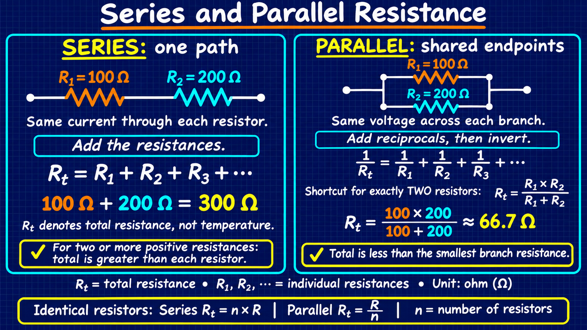

# Resistors · Grades 9–10

[← Grade topic library](../README.md) · [Shared resistor notes](../../Shared_Resources/Resistors/)

## Assignments

- [Resistor bell ringer](Resistor_Bell_Ringer.pdf)
- [Resistor identification lab](Resistor_Identification.pdf)
- [Worked example](Worked_Example3.pdf)

## Series and parallel resistance

[Open full-size image](Series-and-Parallel-Resistance.png) · [Open printable image notes](https://codencreateacademy.github.io/pslca-student-hub/Shared_Resources/Resistors/series-parallel-resistance.html)

Use this reference when studying how resistors combine in series and parallel. Keep your calculations and reasoning with your classwork.
