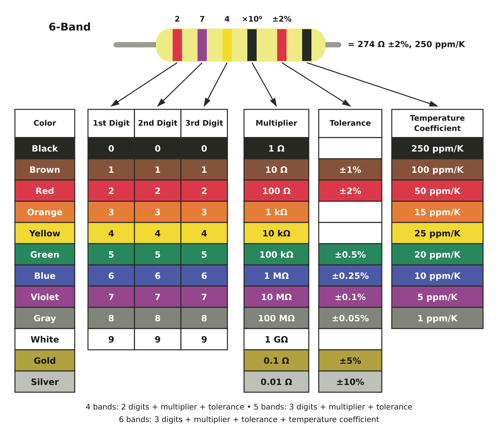

# Resistor Color-Code Chart

**Shared resource · All classes**

[Open full-size chart](resistor-color-code.svg) · [Open printable page](resistor-color-code.html)

## How to read the bands

- **4 bands:** two digits → multiplier → tolerance.
- **5 bands:** three digits → multiplier → tolerance.
- **6 bands:** three digits → multiplier → tolerance → temperature coefficient.

Write the digits next to one another, then multiply. Tolerance describes the allowed variation from the marked resistance.

## Accessible reference table

| Color | Digit | Multiplier | Tolerance | Temperature coefficient |
| --- | --- | --- | --- | --- |
| Black | 0 | ×1 | — | 250 ppm/K |
| Brown | 1 | ×10 | ±1% | 100 ppm/K |
| Red | 2 | ×100 | ±2% | 50 ppm/K |
| Orange | 3 | ×1,000 | — | 15 ppm/K |
| Yellow | 4 | ×10,000 | — | 25 ppm/K |
| Green | 5 | ×100,000 | ±0.5% | 20 ppm/K |
| Blue | 6 | ×1,000,000 | ±0.25% | 10 ppm/K |
| Violet | 7 | ×10,000,000 | ±0.1% | 5 ppm/K |
| Gray | 8 | ×100,000,000 | ±0.05% | 1 ppm/K |
| White | 9 | ×1,000,000,000 | — | — |
| Gold | — | ×0.1 | ±5% | — |
| Silver | — | ×0.01 | ±10% | — |

A dash means the color is not used in that column. No tolerance band means ±20% on a three-band resistor.

**Examples:** yellow–violet–red–gold = 4.7 kΩ ±5%; red–violet–yellow–black–red = 274 Ω ±2%; adding a black sixth band gives 250 ppm/K.

Read from the end with the first band nearest the edge; the tolerance band is often spaced apart. Confirm ambiguous markings against the manufacturer’s datasheet. Disconnect power before measuring resistance.

Values checked against [Panasonic’s resistor color-code reference](https://industrial.panasonic.com/ww/ds/resistor-color-code-calculator).

[Back to student hub](../README.md)
