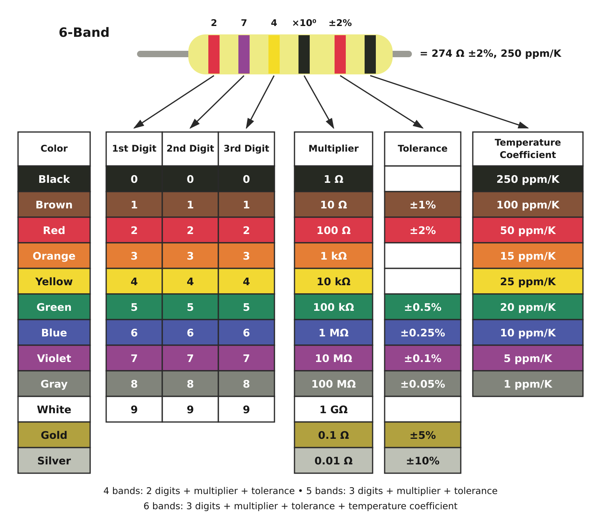

# Resistor Color-Code Chart

**Shared resource · All classes**

[Open full-size chart](resistor-color-code.svg) · [Open printable page](https://codencreateacademy.github.io/pslca-student-hub/Shared_Resources/Resistors/resistor-color-code.html)

## How to read the bands

- **4 bands:** two digits → multiplier → tolerance.
- **5 bands:** three digits → multiplier → tolerance.
- **6 bands:** three digits → multiplier → tolerance → temperature coefficient.

Write the digits next to one another, then multiply. Tolerance describes the allowed variation from the marked resistance.

## Accessible reference table

| Color | Digit | Multiplier | Tolerance | Temperature coefficient |
| --- | --- | --- | --- | --- |
| Black | 0 | ×1 | — | 250 ppm/K |
| Brown | 1 | ×10 | ±1% | 100 ppm/K |
| Red | 2 | ×100 | ±2% | 50 ppm/K |
| Orange | 3 | ×1,000 | — | 15 ppm/K |
| Yellow | 4 | ×10,000 | — | 25 ppm/K |
| Green | 5 | ×100,000 | ±0.5% | 20 ppm/K |
| Blue | 6 | ×1,000,000 | ±0.25% | 10 ppm/K |
| Violet | 7 | ×10,000,000 | ±0.1% | 5 ppm/K |
| Gray | 8 | ×100,000,000 | ±0.05% | 1 ppm/K |
| White | 9 | ×1,000,000,000 | — | — |
| Gold | — | ×0.1 | ±5% | — |
| Silver | — | ×0.01 | ±10% | — |

A dash means the color is not used in that column. No tolerance band means ±20% on a three-band resistor.

**Examples:** yellow–violet–red–gold = 4.7 kΩ ±5%; red–violet–yellow–black–red = 274 Ω ±2%; adding a black sixth band gives 250 ppm/K.

Read from the end with the first band nearest the edge; the tolerance band is often spaced apart. Confirm ambiguous markings against the manufacturer’s datasheet. Disconnect power before measuring resistance.

Values checked against [Panasonic’s resistor color-code reference](https://industrial.panasonic.com/ww/ds/resistor-color-code-calculator).

[Back to student hub](../../README.md)

## Series and parallel resistance

**R_T** means total (equivalent) resistance. **R1, R2, ...** are the individual resistances. Resistance is measured in **ohms (Ω)**. Use the same unit throughout a calculation.

### Resistors in series: add the resistances

One path carries the same current through every resistor.

**R_T = R1 + R2 + R3 + ...**

Example: 100 Ω + 200 Ω + 300 Ω = **600 Ω**.

For **n identical resistors** of resistance R: **R_T = n × R**.

Check: for positive resistances, a series total is greater than any one resistor when two or more are connected.

### Resistors in parallel: add reciprocals, then invert

Each branch connects across the same two points, so every branch has the same voltage.

**1/R_T = 1/R1 + 1/R2 + 1/R3 + ...**

Then take the reciprocal of the sum to find **R_T**. Do not stop at **1/R_T**.

Example: 1/R_T = 1/100 + 1/200 = 0.015, so R_T = 1/0.015 = **66.7 Ω** (rounded).

For **exactly two resistors**, the shortcut is **R_T = (R1 × R2) / (R1 + R2)**.

For **n identical parallel resistors**: **R_T = R/n**. Two 330 Ω resistors give **165 Ω**.

Check: with two or more positive resistors in parallel, the total is less than the smallest individual resistance.

### Connect resistance to current

For an ohmic load, **I = V/R_T**. At the same supply voltage, greater total resistance means less total current. A series/parallel network must be reduced by identifying the connections; do not apply the two-resistor parallel shortcut to three resistors at once.

[Open printable series/parallel notes](https://codencreateacademy.github.io/pslca-student-hub/Shared_Resources/Resistors/series-parallel-resistance.html)

Formula reference: [OpenStax: Resistors in Series and Parallel](https://openstax.org/books/university-physics-volume-2/pages/10-2-resistors-in-series-and-parallel).

---

Original chart resources published **October 29, 2026**. Series/parallel notes added **November 19, 2026**. The original Git history is preserved.
